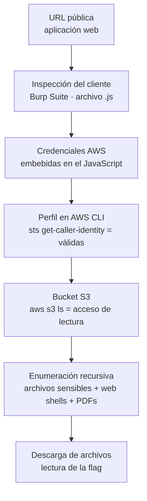

# ☁️ Pentesting en AWS: Brecha en S3 por credenciales expuestas (CloudGoat `cloud_breach_s3`)

[](https://aws.amazon.com/)
[](https://github.com/RhinoSecurityLabs/cloudgoat)
[](https://www.kali.org/)
[](https://www.zaproxy.org/)
[](./LICENSE)
[]()

> Laboratorio de **pentesting cloud** que parte **solo de una URL pública**, sin credenciales ni información previa. El hilo del ataque: credenciales de AWS **embebidas en el JavaScript del lado cliente** → acceso a un **bucket S3** mal configurado → lectura de archivos sensibles y de una *flag*.

---

## 📋 Tabla de contenidos

- [Escenario](#-escenario)
- [Cadena de ataque](#️-cadena-de-ataque)
- [Herramientas](#️-herramientas)
- [Hallazgos](#-hallazgos)
- [Recomendaciones de remediación](#️-recomendaciones-de-remediación)
- [Estructura del repositorio](#-estructura-del-repositorio)
- [Aprendizajes](#-aprendizajes)
- [Autora](#-autora)

---

## 🎯 Escenario

Punto de partida: una **aplicación web corporativa** accesible por Internet. El objetivo era identificar y explotar debilidades de un entorno **AWS** partiendo de cero, y además reproducir el escenario `cloud_breach_s3` de CloudGoat, que simula una brecha por malas configuraciones en S3 y en la gestión de identidades (IAM).

---

## ⚔️ Cadena de ataque



| Fase | Acción | Resultado |
|---|---|---|
| 1. Reconocimiento | Revisión del sitio y de sus recursos JavaScript con Burp Suite | Se detecta un `.js` con secretos |
| 2. Exposición de secretos | Lectura del script del lado cliente | Access Key, Secret Key, nombre del bucket y región de AWS |
| 3. Validación | Perfil en AWS CLI + `sts get-caller-identity` | Las credenciales son válidas y operativas |
| 4. Acceso a S3 | `aws s3 ls` sobre el bucket | Listado del contenido (configuración IAM demasiado permisiva) |
| 5. Enumeración | `aws s3 ls --recursive` | Archivos de configuración, *web shells* (`cmd.php`, `shell.php`), PDFs y `secret.txt` |
| 6. Impacto | Descarga de archivos | Lectura de la *flag* → confidencialidad comprometida |
| 7. Análisis dinámico | OWASP ZAP como proxy | Tráfico HTTP y alertas (formularios, campos de contraseña, scripts) |

> El escenario también incluyó listar los escenarios de CloudGoat (`cloudgoat list`), crear `cloud_breach_s3` y validar los perfiles de AWS configurados (`aws sts get-caller-identity` sobre cada uno).

📄 Comandos con valores genéricos en [`docs/comandos.md`](./docs/comandos.md).

---

## 🛠️ Herramientas

| Herramienta | Uso |
|---|---|
| **Burp Suite** | Inspección de recursos del lado cliente |
| **AWS CLI v2** | Validación de credenciales y acceso a S3 |
| **CloudGoat** | Despliegue del escenario `cloud_breach_s3` |
| **OWASP ZAP** | Análisis dinámico del tráfico HTTP |
| **Kali Linux** | Máquina atacante |

---

## 🚨 Hallazgos

| # | Hallazgo | Severidad | Impacto |
|---|---|---|---|
| 1 | **Credenciales AWS en el JavaScript del cliente** | 🔴 Crítica | Cualquier visitante obtiene claves válidas de la cuenta |
| 2 | **Bucket S3 legible** con credenciales de bajo privilegio | 🔴 Crítica | Fuga de archivos internos, PDFs y *web shells* |
| 3 | **Web shells almacenadas** en el bucket (`cmd.php`, `shell.php`, `readflag.php`) | 🟠 Alta | Riesgo de ejecución remota de comandos si se sirven en producción |
| 4 | Material de laboratorio y archivos de prueba persistentes en el entorno | 🟡 Media | Exposición de información de soporte |

---

## 🛡️ Recomendaciones de remediación

- **Nunca** poner credenciales en código del lado cliente. Rotar de inmediato cualquier clave expuesta.
- Usar **roles IAM** y **AWS Secrets Manager** en lugar de claves estáticas.
- Aplicar **mínimo privilegio** en las políticas IAM (restringir `s3:ListBucket` y `s3:GetObject` a lo imprescindible).
- **Block Public Access** a nivel de cuenta y de bucket; revisar políticas y ACL.
- **Auditar** los buckets (quitar *web shells* y archivos de prueba) y activar CloudTrail + GuardDuty.

---

## 📁 Estructura del repositorio

```
.
├── README.md
├── LICENSE
└── docs/
    └── comandos.md    # Validación de credenciales y enumeración de S3 (valores genéricos)
```

---

## 💡 Aprendizajes

- ✅ **El código del lado cliente es público por definición.** Todo secreto que llegue al navegador se considera comprometido.
- ✅ **Una mala configuración de S3 basta para una brecha**, sin explotar ningún software.
- ✅ **Reconocimiento → validación → enumeración → impacto**: la metodología funciona aun partiendo solo de una URL.
- ✅ **Rotar credenciales** es lo primero ante una exposición; el resto son medidas de fondo.

---

## 👩‍💻 Autora

**Catalina Rebolledo Rojas** · [@Cataliniwis](https://github.com/Cataliniwis)

*Diplomado en Red Team* · 2025

---

## 📄 Licencia

Este proyecto se distribuye bajo la licencia MIT. Ver [LICENSE](./LICENSE).

---

> ⚠️ **Disclaimer:** laboratorio académico (CloudGoat + entorno de certificación) en una cuenta propia. Las credenciales, los IDs de cuenta, las URLs, los nombres de bucket y las *flags* fueron omitidos o reemplazados. **No apliques estas técnicas sobre infraestructura sin autorización.**
